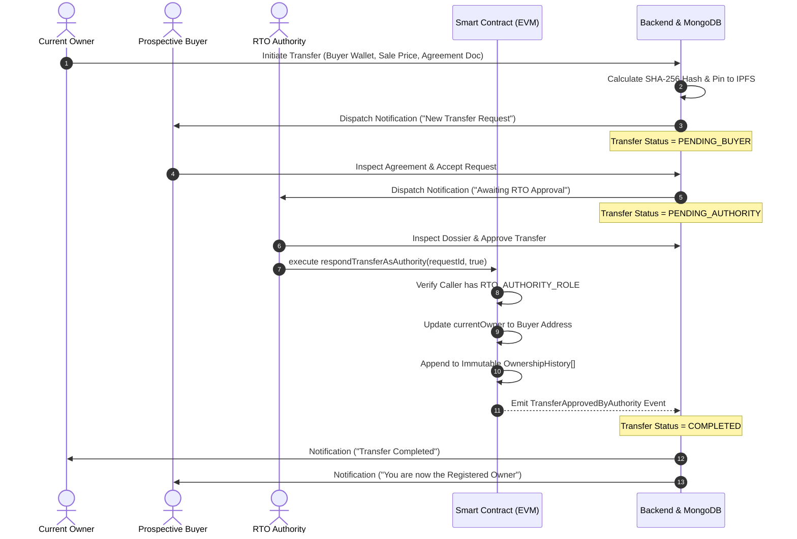

# 🚗 VehicleChain: Blockchain-Based Vehicle Ownership Transfer and Registration System

[](https://soliditylang.org/)
[](https://hardhat.org/)
[](https://docs.ethers.org/)
[](https://openzeppelin.com/)
[](https://react.dev/)
[](https://www.typescriptlang.org/)
[](https://tailwindcss.com/)
[](https://nodejs.org/)
[](LICENSE)

An academic, final-year engineering prototype engineered to establish an immutable, decentralized, and tamper-evident registry for vehicle registration, cryptographic document verification, and multi-party vehicle ownership transfer.

---

## 📋 Table of Contents
- [1. Executive Summary & Problem Statement](#1-executive-summary--problem-statement)
- [2. System Architecture](#2-system-architecture)
- [3. Key Architectural Innovations](#3-key-architectural-innovations)
- [4. Indian HSRP Number Plate Design System](#4-indian-hsrp-number-plate-design-system)
- [5. Role-Based Access Control (RBAC)](#5-role-based-access-control-rbac)
- [6. Multi-Party Transfer Workflow](#6-multi-party-transfer-workflow)
- [7. Smart Contract State Machine](#7-smart-contract-state-machine)
- [8. Technology Stack](#8-technology-stack)
- [9. Project Structure](#9-project-structure)
- [10. Step-by-Step Installation & Setup](#10-step-by-step-installation--setup)
- [11. Pre-Configured Demo Accounts](#11-pre-configured-demo-accounts)
- [12. Testing & Quality Assurance](#12-testing--quality-assurance)
- [13. Academic Viva & Defense Demonstration Script](#13-academic-viva--defense-demonstration-script)
- [14. Disclaimer](#14-disclaimer)

---

## 1. Executive Summary & Problem Statement

### The Problem
Traditional, centralized vehicle registration systems (such as legacy regional transport office databases) suffer from critical vulnerabilities:
1. **Document Forgery & Title Fraud**: Paper registration certificates (Form 23) and sale agreements are frequently manipulated or falsified to resell stolen, financed, or salvaged vehicles.
2. **Vehicle Cloning (Ghost Vehicles)**: Fraudsters clone existing legitimate Vehicle Identification Numbers (VIN) and registration plates onto stolen cars.
3. **Single Point of Failure**: Centralized databases can be tampered with through insider manipulation, administrative corruption, or unauthorized database record alteration.
4. **Opaque Ownership Transition**: Private second-hand car transactions lack atomic, verifiable handoffs between sellers, buyers, and regulatory authorities.

### The VehicleChain Solution
**VehicleChain** replaces paper-based and siloed records with an **EVM-compatible decentralized state machine**:
- **Smart-Contract Authority**: Every vehicle registration and ownership change requires on-chain cryptographic consensus.
- **Cryptographic Document Anchors**: Official Registration Certificates and Sale Deeds are fingerprinted via **SHA-256 hashes** and pinned to **IPFS**. Any modification to a document produces a mismatched hash, instantly exposing forgery.
- **3-Party Consensus Protocol**: An ownership transfer requires mutual cryptographic agreement: the **Owner initiates**, the **Buyer inspects and signs acceptance**, and the **RTO Authority validates and executes the transfer on-chain**.
- **Privacy-Safe Public Verification**: Anyone can scan a vehicle's QR code to verify its legal status and transaction history without exposing the owner's personal identity or contact information.

---

## 2. System Architecture

```
+---------------------------------------------------------------------------------------+
|                                1. PRESENTATION LAYER                                  |
|  React 18 (Vite) | TypeScript | Tailwind CSS | Framer Motion | Lucide Icons           |
|  - Indian HSRP Plate Design System (3D Embossed Typography, Chrome Emblem, Rivets)   |
|  - MetaMask Web3 Integration (Ethers.js v6) | HTML5-QRCode Scanner                    |
|  - Role Portals: Authority Portal, Owner Garage, Buyer Transferee, Public Verifier   |
+-------------------------------------------+-------------------------------------------+
                                            | REST API (JSON / Multipart)
+-------------------------------------------v-------------------------------------------+
|                                  2. APPLICATION LAYER                                 |
|  Node.js + Express.js + TypeScript                                                    |
|  - JWT Authentication & RBAC Middleware                                               |
|  - Input Validation (Zod Schemas) & Helmet / Rate-Limiter Security                    |
|  - Cryptographic Hash Engine (SHA-256 Document Verification)                          |
|  - Smart Contract Orchestration Service (Ethers.js JsonRpcProvider & Signer)          |
|  - In-App Real-Time Notification Engine & Immutable Audit Logger                      |
+---------------------+-----------------------------------------+-----------------------+
                      |                                         |
+---------------------v--------------------+  +-----------------v-----------------------+
|         3. PERSISTENCE LAYER             |  |        4. BLOCKCHAIN LAYER              |
| - MongoDB (Mongoose Schemas)             |  | - VehicleRegistry.sol (Solidity 0.8.24) |
| - Zero-Install Embedded Mongo Server     |  | - OpenZeppelin AccessControl (v5.0.2)   |
| - IPFS Storage Adapter (Pinata / Mock)   |  | - OpenZeppelin ReentrancyGuard          |
| - Dynamic QR Code Data URL Generator     |  | - Hardhat Local EVM (Chain ID: 31337)   |
+------------------------------------------+  +-----------------------------------------+
```

---

## 3. Key Architectural Innovations

1. **Dual-Layer Synchronization (Database + Blockchain)**:
   - MongoDB acts as a high-speed querying cache for searchable tables, user profiles, and application logs.
   - The Solidity Smart Contract remains the **absolute authoritative ground truth** for vehicle status, current owner address, and historical transfers.
2. **Zero-Configuration In-Memory Database Fallback**:
   - If an external MongoDB instance is not detected, the backend dynamically spins up an embedded in-memory MongoDB instance via `mongodb-memory-server`, allowing instant out-of-the-box local execution.
3. **Decentralized Document Integrity**:
   - Files are never stored raw on the blockchain. Instead, the SHA-256 hash and IPFS CID are anchored to the contract.
   - An integrated **Live Document Verifier** allows any user to upload a scanned PDF/image to calculate its hash in real time and match it against the blockchain record.
4. **Public Privacy Protection**:
   - Public verification queries automatically mask wallet identifiers (e.g. `0x7099...79c8`) and redact private fields (phone numbers, email addresses, passwords, sale values).

---

## 4. Indian HSRP Number Plate Design System

A standout design requirement of this application is its authentic **High Security Registration Plate (HSRP)** visual identity:
- **Pure CSS/HTML Typography**: Uses custom typography styling with 3D embossed drop shadows (`hsrp-emboss-black` / `hsrp-emboss-dark`) without relying on static raster images.
- **Authentic Plate Elements**:
  - Hot-stamped chromium **Ashok Chakra** hologram emblem.
  - Left blue **IND** country designation badge.
  - Laser-engraved 10-digit serial identifier (`000453`).
  - Realistic metal plate bevel border with metallic fastener rivets.
- **Fictional Specimen Plate**: Centered on the specimen plate **`AP 39 AB 2026`**, clearly designated as an academic design model.
- **Modular Reusable Components**:
  - `<NumberPlateBackground />`: Configurable backdrop motif with ambient blue glow.
  - `<NumberPlateBadge />`: Compact plate graphic for table rows, headers, and certificates.

---

## 5. Role-Based Access Control (RBAC)

| Role | Permitted Actions | Dashboard Route |
| :--- | :--- | :--- |
| **Administrator / RTO Authority** | • Register vehicles on-chain<br>• Inspect submitted RC documents<br>• Approve or reject transfer requests<br>• Update vehicle status (ACTIVE / SUSPENDED / DEREGISTERED)<br>• Review system audit trails | `/dashboard/authority` |
| **Current Vehicle Owner** | • View personal registered garage<br>• Initiate ownership transfer to a buyer wallet<br>• Upload Form 29/30 transfer deeds<br>• Cancel unaccepted transfer requests<br>• Download printable Form 23 Digital Certificate | `/dashboard/owner` |
| **Prospective Buyer** | • Receive incoming transfer requests<br>• Review vehicle specs & cryptographic agreement hash<br>• Formally accept or reject transfer requests<br>• Access updated certificate post-approval | `/dashboard/buyer` |
| **Public Verifier / Citizen** | • Search vehicle registry by ID or plate number<br>• Scan physical vehicle QR codes<br>• Test document copies against on-chain SHA-256 hashes<br>• View sanitized chronological ownership chain | `/verify` |

---

## 6. Multi-Party Transfer Workflow



---

## 7. Smart Contract State Machine

The smart contract [`VehicleRegistry.sol`](file:///C:/Users/addep/VehicleChain/blockchain/contracts/VehicleRegistry.sol) enforces strict state transitions and access controls:

### Enums
```solidity
enum VehicleStatus {
    ACTIVE,        // 0: Vehicle legally operational and transferable
    SUSPENDED,     // 1: Temporarily locked by RTO; active transfers auto-cancelled
    DEREGISTERED   // 2: Permanently scrapped or cancelled; transfers blocked
}

enum TransferStatus {
    NONE,
    PENDING_BUYER,     // Awaiting buyer acceptance
    PENDING_AUTHORITY, // Awaiting RTO adjudication
    APPROVED,          // Approved by authority
    REJECTED,          // Rejected by buyer or authority
    COMPLETED,         // Recorded on-chain; ownership updated
    CANCELLED          // Cancelled by owner prior to buyer response
}
```

### Security Invariants & Protections
- **OpenZeppelin AccessControl**: Strictly enforces `RTO_AUTHORITY_ROLE` for vehicle creation and transfer adjudication.
- **OpenZeppelin ReentrancyGuard**: Prevents reentrant calls on state-changing transfer functions.
- **Stack Too Deep Resolution**: Optimized using Solidity 0.8.24 via IR code generation (`viaIR: true`).
- **Duplicate Prevention**: Reverts with custom errors `VehicleAlreadyExists`, `RegNumberAlreadyExists`, and `VinAlreadyExists`.
- **Ownership Invariant**: Only the current registered owner address can initiate a transfer; caller spoofing is cryptographically impossible.

---

## 8. Technology Stack

### Blockchain Layer
- **Solidity `0.8.24`**: High-performance smart contract language.
- **Hardhat `2.22.2`**: Development framework for compiling, testing, and deploying.
- **Ethers.js `v6.11.1`**: Web3 provider and contract interaction library.
- **OpenZeppelin Contracts `v5.0.2`**: Industry-standard access control and security utilities.

### Backend Layer
- **Node.js & Express.js (TypeScript)**: Clean REST API architecture.
- **Mongoose `8.3.1`**: MongoDB object modeling.
- **mongodb-memory-server `9.1.8`**: Embedded in-memory database for zero-config demo runs.
- **bcryptjs & jsonwebtoken (JWT)**: Secure password hashing and session tokens.
- **Zod `3.22.4`**: Strict request schema validation.
- **Multer**: In-memory file processing for cryptographic hashing.
- **QRCode**: Dynamic server-side QR data generation.

### Frontend Layer
- **React 18 with Vite**: Lightning-fast compilation and HMR.
- **TypeScript**: Full end-to-end type safety.
- **Tailwind CSS 3.4**: Custom automotive HSRP styling and responsive layouts.
- **Lucide React**: Clean vector iconography.
- **Framer Motion**: Restrained, elegant animations.
- **HTML5-QRCode**: Web-camera vehicle QR scanner integration.
- **Canvas-Confetti**: Interactive celebratory feedback upon successful actions.

---

## 9. Project Structure

```
VehicleChain/
├── .gitignore                            # Excludes node_modules, cache, dist, artifacts, etc.
├── package.json                          # Monorepo task orchestration scripts
├── README.md                             # Comprehensive project documentation
├── docs/                                 # Detailed architectural documents
│   ├── architecture.md                   # System layers, data flow & security model
│   ├── setup.md                          # Step-by-step setup prerequisites
│   ├── api.md                            # Comprehensive REST API reference
│   └── testing.md                        # Smart contract & backend test guides
├── blockchain/                           # EVM Smart Contracts & Hardhat
│   ├── contracts/
│   │   └── VehicleRegistry.sol           # Core registry & transfer state machine
│   ├── deployments/
│   │   └── VehicleRegistry.json          # Deployment address & network metadata
│   ├── scripts/
│   │   └── deploy.ts                     # Local & testnet deployment script
│   ├── test/
│   │   └── VehicleRegistry.test.ts       # 16 unit tests for all security boundaries
│   ├── hardhat.config.ts
│   └── package.json
├── backend/                              # Express.js + TypeScript REST API
│   ├── src/
│   │   ├── config/                       # Database (with auto-memory fallback) & Env
│   │   ├── controllers/                  # Auth, Vehicle, Transfer, Public, Notifications
│   │   ├── middleware/                   # JWT auth, RBAC, Zod validation, error handler
│   │   ├── models/                       # User, Vehicle, TransferRequest, DocumentMetadata
│   │   ├── routes/                       # Express route definitions
│   │   ├── scripts/                      # Auto-seeding script with demo accounts
│   │   ├── services/                     # Blockchain, IPFS/Storage, QR, Audit, Notifications
│   │   ├── validators/                   # Zod schemas
│   │   ├── app.ts                        # Express app setup (CORS, Helmet, Rate Limit)
│   │   └── server.ts                     # Server entrypoint
│   ├── tests/
│   │   └── api.test.ts                   # 13 backend unit & integration tests
│   └── package.json
└── frontend/                             # React 18 + Vite + Tailwind CSS
    ├── public/
    │   └── shield.svg                    # Automotive vector brand favicon
    ├── src/
    │   ├── components/
    │   │   ├── NumberPlateBackground.tsx # Realistic HSRP plate background motif
    │   │   ├── NumberPlateBadge.tsx      # Compact 3D embossed plate badge
    │   │   ├── DocumentVerifierModal.tsx # Real-time SHA-256 tamper detection modal
    │   │   ├── OwnershipTimeline.tsx     # Chronological ownership history chain
    │   │   ├── StatusPill.tsx            # Glowing state badges
    │   │   ├── Navbar.tsx                # Role-aware nav, notifications & wallet status
    │   │   └── Footer.tsx
    │   ├── contexts/
    │   │   ├── AuthContext.tsx           # Session management & role persistence
    │   │   └── WalletContext.tsx         # MetaMask Web3 connectivity & event sync
    │   ├── pages/
    │   │   ├── LandingPage.tsx           # Automotive hero with plate centerpiece & metrics
    │   │   ├── LoginPage.tsx             # 1-Click demo fill buttons for presentation
    │   │   ├── RegisterPage.tsx          # Multi-role account registration
    │   │   ├── AuthorityDashboard.tsx    # RTO adjudication portal & master registry
    │   │   ├── OwnerDashboard.tsx        # Garage asset manager & transfer initiator
    │   │   ├── BuyerDashboard.tsx        # Transferee portal with agreement inspection
    │   │   ├── RegisterVehiclePage.tsx   # Live plate preview & on-chain minting
    │   │   ├── InitiateTransferPage.tsx  # Form 29/30 transfer workflow
    │   │   ├── TransferDetailsPage.tsx   # 3-step lifecycle progress tracker
    │   │   ├── VehicleDetailsPage.tsx    # Plate header, specs & ownership history
    │   │   ├── PublicVerifyPage.tsx      # Public query & privacy-safe verification
    │   │   ├── QrScannerPage.tsx         # Camera QR code reader
    │   │   └── DigitalCertificatePage.tsx# Printable Form 23 RC Certificate with QR
    │   ├── services/api.ts               # Axios client with bearer token interceptor
    │   └── styles/index.css              # Custom HSRP plate embossing CSS
    └── package.json
```

---

## 10. Step-by-Step Installation & Setup

### Prerequisites
- **Node.js**: v18.0.0 or later (v20+ recommended).
- **npm**: v9.0.0 or later.
- **Git**: Installed and configured.
- **MetaMask**: Browser extension for Web3 interactions (optional for simulated tests).

### Step 1: Clone the Repository
```bash
git clone https://github.com/AviAvinash770/VehicleChain.git
cd VehicleChain
```

### Step 2: Install All Dependencies
Install root, blockchain, backend, and frontend packages with a single command:
```bash
npm run install:all
```

### Step 3: Start the Local Blockchain Node
Open **Terminal 1**:
```bash
cd blockchain
npx hardhat node
```
*This starts a local EVM blockchain on `http://127.0.0.1:8545` with 20 pre-funded test accounts (10,000 ETH each).*

### Step 4: Deploy the Smart Contract
Open **Terminal 2**:
```bash
cd blockchain
npx hardhat run scripts/deploy.ts --network localhost
```
*The script deploys `VehicleRegistry.sol` and automatically saves its address and ABI to `blockchain/deployments/VehicleRegistry.json`.*

### Step 5: Start the Backend Server
Open **Terminal 3**:
```bash
cd backend
npm run dev
```
*The server boots at `http://localhost:5000`. If no local MongoDB is detected, it automatically starts an embedded in-memory MongoDB instance and auto-seeds all demo accounts and specimen vehicle `AP 39 AB 2026`.*

### Step 6: Start the Frontend Application
Open **Terminal 4**:
```bash
cd frontend
npm run dev
```
*Open **[http://localhost:5173](http://localhost:5173)** in your web browser.*

---

## 11. Pre-Configured Demo Accounts

On the **Sign In** page (`/login`), click any of the **"1-Click Fill"** buttons to log in instantly without manually typing credentials:

| Role | Email | Password | Pre-Funded Hardhat Wallet |
| :--- | :--- | :--- | :--- |
| **RTO Authority** | `authority@vehiclechain.gov.in` | `Password@123` | Hardhat #0 (`0xf39fd6e51aad88f6f4ce6ab8827279cfffb92266`) |
| **Current Owner (Seller)** | `owner@vehiclechain.gov.in` | `Password@123` | Hardhat #1 (`0x70997970c51812dc3a010c7d01b50e0d17dc79c8`) |
| **Prospective Buyer** | `buyer@vehiclechain.gov.in` | `Password@123` | Hardhat #2 (`0x3c44cdddb6a900fa2b585dd299e03d12fa4293bc`) |
| **Public Verifier** | `verifier@vehiclechain.gov.in` | `Password@123` | Hardhat #3 (`0x90f79bf6eb2c4f870365e785982e1f101e93b906`) |

---

## 12. Testing & Quality Assurance

### A. Smart Contract Unit Tests
16 comprehensive unit tests validating access control, transfer validation, edge cases, and tamper detection:
```bash
cd blockchain
npx hardhat test
```
```text
  VehicleRegistry Smart Contract Tests
    1. Roles and Deployment
      √ Should grant RTO_AUTHORITY_ROLE to deployer and specified authority
    2. Vehicle Registration
      √ Should allow authorized RTO authority to register a vehicle
      √ Should reject duplicate vehicle registration (same vehicleId)
      √ Should reject registration if registration number or VIN already exists
      √ Should reject vehicle registration by unauthorized callers
    3. Ownership Transfer Workflow
      √ Should allow current owner to initiate transfer to buyer
      √ Should reject transfer initiation from non-owner
      √ Should reject transfer if vehicle is suspended
      √ Should prevent duplicate pending transfer requests for the same vehicle
      √ Should allow buyer to accept transfer request
      √ Should reject buyer response from unauthorized user
      √ Should allow buyer to reject transfer request with reason
      √ Complete workflow: Buyer accepts, Authority approves, ownership updates
      √ Should reject non-authority caller attempting to approve transfer
      √ Should allow authority to reject transfer with reason without changing owner
    4. Document Integrity Verification
      √ Should verify registered document hashes and reject untrusted hashes

  16 passing (3s)
```

### B. Backend API Integration Tests
13 automated tests covering authentication, RBAC, input sanitization, and document verification:
```bash
cd backend
npm test
```
```text
 ✓ tests/api.test.ts (13 tests) 2623ms
 Test Files  1 passed (1)
      Tests  13 passed (13)
```

### C. Frontend Production Build Check
```bash
cd frontend
npm run build
```
```text
✓ 2034 modules transformed.
✓ built in 19.00s with zero TypeScript or bundling errors.
```

---

## 13. Academic Viva & Defense Demonstration Script

When presenting this project during an academic review or viva defense, follow this structured demonstration:

### Step 1: Introduction & Visual Identity Showcase
1. Open `http://localhost:5173`.
2. Point out the **Indian HSRP Number Plate centerpiece** (`AP 39 AB 2026`), explaining that the application models Indian High Security Registration Plates with 3D embossed typography, hot-stamped hologram, and blue `IND` strip.
3. Highlight the live blockchain metrics bar reflecting real-time on-chain registrations.

### Step 2: Public Verification & Privacy Protection
1. Click **"Verify Vehicle"** or search `AP 39 AB 2026`.
2. Show that the vehicle's active status, model (`Tata Nexon EV`), and genesis transaction hash are publicly verifiable.
3. Highlight the **privacy protection feature**: the owner's wallet is masked (`0x7099...79c8`), and personal contact details are completely redacted from public queries.

### Step 3: Real-Time Document Tamper Detection
1. In the Public Verification page, scroll to **"Verify a Physical Document Copy"**.
2. Click **"Check Hash"** with the original document to show the green **"Cryptographic Match Confirmed"** badge.
3. Upload a slightly modified file to demonstrate the red **"Integrity Mismatch Detected"** alert, proving mathematical tamper-evidence via SHA-256.

### Step 4: Complete Multi-Party Ownership Transfer
1. **Initiation**: Sign in as **Owner** (`owner@vehiclechain.gov.in`). Go to *Initiate Ownership Transfer*, select vehicle `AP 39 AB 2026`, specify the buyer's wallet (`0x3c44...93bc`), and submit.
2. **Acceptance**: Sign in as **Buyer** (`buyer@vehiclechain.gov.in`). View the incoming request in the Buyer Transferee portal, inspect the agreement hash, and click **"Accept Transfer"**.
3. **Adjudication**: Sign in as **RTO Authority** (`authority@vehiclechain.gov.in`). Navigate to *Pending Approvals*, review the mutual dossier, and click **"Approve & Record"**.
4. **On-Chain Confirmation**: Show that the smart contract executes the state change. The vehicle now appears in the Buyer's garage with updated ownership history!

### Step 5: Form 23 Digital Certificate
1. Open vehicle details and click **"Digital Certificate"**.
2. Display the official, printable Government of India Form 23 Certificate of Registration with the vehicle's dynamic verification QR code, blockchain transaction hash, and SHA-256 seal.

---

## 14. Disclaimer

This project is an **academic research prototype** developed for engineering degree final-year project demonstration and technical evaluation. It is **not** an official replacement for the Government of India Ministry of Road Transport and Highways (MoRTH) or state RTO databases (Vahan / Sarathi).

---

## 📄 License
This project is licensed under the [MIT License](LICENSE).
